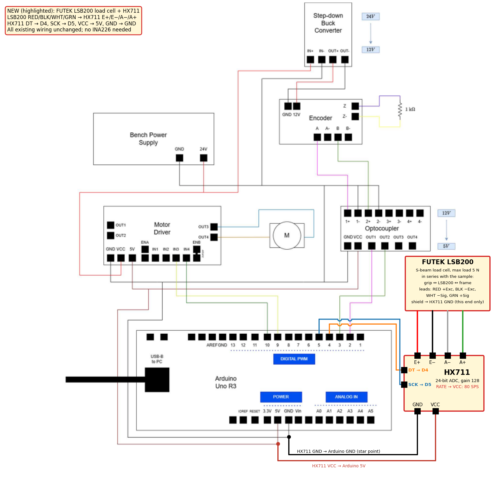

# Load cell (FUTEK LSB200 + HX711): electronics, wiring and firmware

This replaces the current-sensor plan in `WIRING_CHANGES.md`. The sample force is now
measured directly by a FUTEK LSB200 load cell, so the INA226 is no longer needed.
Everything in the existing wiring diagram stays as it is. Only the parts below are added.



The new parts are highlighted in the diagram: the LSB200, the HX711 and their wires. An SVG version is in
`docs/wiring_diagram_loadcell.svg`.

## 1. Why an extra board is needed

The LSB200 is a strain-gauge Wheatstone bridge. It outputs a few millivolts at full load.
The Arduino's 10-bit ADC cannot resolve that: one step is 4.9 mV. An HX711 sits between the bridge
and the Arduino. It is a 24-bit bridge ADC with a gain-128 amplifier. It also excites the bridge from its
own regulator, at about 4.3 V on the usual breakout boards. It sends the result digitally over two wires.

The measurement is ratiometric: the excitation E+ is also the ADC reference. Drift of the 5 V supply
therefore cancels out.

## 2. Parts to add

| Part | Notes |
|---|---|
| FUTEK LSB200 load cell (you have it) | Miniature S-beam, tension and compression. The maximum sample load in this set-up is about 5 N. Its capacity, rated output (mV/V) and wiring code are on its calibration certificate. |
| HX711 breakout board | 24-bit, gain 128. The RATE pin must be reachable (see section 4). |
| Small screw terminal or connector | Takes the thin LSB200 leads, with strain relief. Do not let the moving carriage pull on the cable. |
| Threaded adapters | Match the tapped ends of the LSB200 (thread size from your model's drawing) to the grip and to the frame or carriage. |
| Rod end, clevis or flexure | Keeps bending and torsion out of the S-beam, so that only axial force reaches it. |
| Calibration masses | 100 g, 200 g and 500 g (0.98, 1.96 and 4.90 N) for a multipoint linearity check up to 5 N. |
| Mechanical overload stop (recommended) | The drive can produce far more than 5 N. A hard stop protects the cell if anything goes wrong. |

## 3. Wiring

### LSB200 to HX711

FUTEK's standard 4-wire colour code is shown below. Check it against the wiring code on your
certificate.

| LSB200 lead | Signal | HX711 pin |
|---|---|---|
| Red | +Excitation | E+ |
| Black | −Excitation | E− |
| Green | +Signal | A+ |
| White | −Signal | A− |
| Shield (drain) | Cable screen | HX711 GND, at this end only. FUTEK shields float at the sensor. |

If the force reads negative in tension, swap green and white.

### HX711 to Arduino Uno

| HX711 pin | Arduino | Notes |
|---|---|---|
| VCC (and VDD, if the board has a separate logic supply pin) | 5V | Use the ICSP header 5V pin, or splice into the existing 5V net. |
| GND | GND | Use the free GND pin next to D13. Keep it a star point, away from the motor return current. |
| DT (DOUT) | **D4** | Data. |
| SCK (PD_SCK) | **D5** | Clock. |
| RATE | VCC | Selects 80 samples/s (section 4). |

D4 and D5 are unused in the current diagram, so no existing wire moves. The pins in use after
the change are:

| Pin | Use |
|---|---|
| D2, D3 | Encoder A/B via optocoupler OUT1/OUT2 (unchanged) |
| D4, D5 | HX711 DT, SCK (**new**) |
| D9, D10 | Motor driver IN3/IN4 (unchanged) |
| 5V, GND | Also supply the HX711 (**new**) |
| A4, A5 | Free (the INA226 is no longer needed) |

## 4. HX711 settings and signal budget

- **80 samples/s.** The HX711 runs at 10 samples/s when its RATE pin (pin 15) is low, and many
  breakouts tie it to GND. Cut that trace, or lift the pin, and connect RATE to VCC. Some boards
  have a solder jumper for this. 80 samples/s is needed for force feedback: the force loop is
  designed for about 12 rad/s (2 Hz) and should stay well below the sample rate.
- **Signal size at 5 N.** The bridge gives at most RO × E ≈ 2 mV/V × 4.3 V = 8.6 mV for a 2 mV/V
  cell at full load. The HX711 range at gain 128 is ±0.5·E/128 ≈ ±16.8 mV, so the signal never clips.
  The bridge common mode (≈ E/2 ≈ 2.15 V) is inside the HX711 input range.
- **Excitation.** The HX711 supplies about 4.3 V. That is below the LSB200's maximum excitation rating,
  but confirm it in the datasheet.
- **Resolution.** The HX711 input noise is about 90 nV rms at 80 samples/s and gain 128. For a cell
  rated about 5 N this gives roughly **0.05–0.1 mN rms**, about 1e-5 of full scale. The motor-current
  method of the previous design resolved only about 1.5 N. Resolution scales with the cell capacity:
  a higher-capacity LSB200 resolves proportionally less finely.
- **Initial scale from the certificate.** The HX711 full scale of 2²³ counts equals 0.5·E/128,
  so

  counts per newton = RO[mV/V] · 10⁻³ · 2³¹ / F_rated[N].

  The sketch computes this from `LC_RATED_OUTPUT_MV_V` and `LC_CAPACITY_N`. The calibration below then
  refines it.

## 5. Mounting

- Put the LSB200 **in series with the sample and coaxial with it**: grip → LSB200 → frame or carriage.
  Use the stationary or slower side, so the cable hardly moves.
- Hold the cell body with a spanner while tightening the adapters, so no torque passes through
  the cell.
- Avoid side loads: use a rod end, clevis or flexure on one side.
- The stiffness k that the GUI measures is the series stiffness of sample, LSB200 and frame. It
  equals the sample stiffness when the sample is much softer than the rig, as the thin default
  samples are. To check this, measure a stiff dummy sample (for example a short steel strip). Its
  measured k is the rig stiffness, and it should be much larger than your samples' k. The GUI applies
  no correction: the value is measured, not entered.

## 6. Grounding and noise

- Route the LSB200 cable away from the PWM motor leads (OUT3/OUT4), and never bundle them together.
- Connect the cable shield to HX711 GND only, not at the sensor.
- Take HX711 GND from a separate Arduino GND pin, so motor return current does not flow through it.
- The HX711 boards already have decoupling. If readings jump when the motor runs, add 100 nF plus
  10 µF across VCC–GND close to the HX711.

## 7. Calibration, tare and the force limit

1. Power the stage and leave it 10 minutes with the HX711 on, so the bridge warms up.
2. **Tare**, with the cell unloaded or the sample slack: press *Tare* in the GUI. The firmware averages
   16 samples and stores the offset in EEPROM.
3. **Calibrate** (once, or after re-mounting): hold the LSB200 vertical, or pull it through a
   low-friction pulley. Hang a known mass, enter it in grams and press *Calibrate with hanging mass*.
   The new scale factor is stored in EEPROM. Then check 100 g, 200 g and 500 g against their nominal
   weights (0.98, 1.96 and 4.90 N).
4. **Force limit**: *Set force limit* sends `FLIM`. The default is 5 N, the maximum load of this set-up.
   Set it no higher than your cell's rated capacity. The LSB200's safe-overload rating only covers
   overshoot.

   The firmware checks the limit on every HX711 sample, i.e. every 12.5 ms, and cuts the motor.
   At full speed the stage moves about 5 µm in that time. That is negligible on the thin default
   sample (about 5 mN), but on a very stiff sample it can be several newtons. On stiff samples,
   keep the speed low and fit the mechanical stop.

## 8. Firmware: `firmware/StrainingStage/StrainingStage.ino`

A complete reference sketch for protocol v2. It mirrors the simulated Arduino inside
`ControlInterface4.py`, so its behaviour is the one tested in the GUI's self-test and demo. It has not
been compiled: no Arduino toolchain was available when it was written.

- Install the library **"HX711 Arduino Library" by Bogdan Necula** (Arduino Library Manager).
- Fill in the `TODO` constants from your old sketch and from the certificate:
  - `COUNTS_PER_REV`: encoder counts per output-shaft revolution after ×4 decoding;
  - `ENC_SIGN` and `MOTOR_SIGN`, so that *Outwards* gives positive d and positive u;
  - `LC_CAPACITY_N` and `LC_RATED_OUTPUT_MV_V` for your LSB200;
  - the encoder input mode, and the ω filter if your sketch had a better one.
- **Control law**, every 1 ms:
  u = −(k_ω·ω + k_I·I + k_d·(d − r) + k_F·F + k_int·z) in displacement mode, or with (F − r) in
  force mode, where ż = r − y.
  - Anti-windup is by conditional integration, and u is saturated at ±24 V.
  - Gain and mode changes are bumpless: the integrator is reset so that u does not jump.
  - I is estimated as (u − k_t·ω)/R, which is valid because L/R ≈ 1.8 µs.
- The **stiffness-free gains K0** are compiled in. Jog and preload therefore work before the GUI has
  sent anything, and before anything is known about the sample.
- PWM: Timer1 drives D9/D10 with 10-bit phase-correct PWM at about 7.8 kHz, instead of 8-bit
  `analogWrite`. Keep your own PWM code if you prefer it.
- Reading the HX711 blocks interrupts for about 100 µs. Encoder edges arriving meanwhile are latched
  (one per pin), so this is harmless at the low encoder rates of a tensile test.

### Serial protocol v2 (115200 baud, one command per line)

| PC → Arduino | Meaning |
|---|---|
| `r,k_omega,k_I,k_d,k_F,k_int,mode` | Gains and reference. Mode 0 tracks d (r in m); mode 1 tracks F (r in N). During a ramp the ramp keeps its own reference. |
| `R:<r>` | New reference (cancels a ramp). |
| `RAMP:<target>,<rate>` | Ramp the reference at 1 kHz (m and m/s, or N and N/s), then reply `RAMP done`. |
| `JOG:<dir>,<distance m>,<speed m/s>` | Distance-based manual move under closed-loop displacement control, then reply `JOG done`. A distance of 0 means move continuously until `STOP`. |
| `PRELOAD:<N>` | Move outwards slowly until F ≥ N, stop, and reply `Pre-tensioning complete, controller stopped`. |
| `START`, `STOP`, `RESET` | Start (bumpless), stop the motor, zero the encoder and integrator. |
| `TARE`, `CAL:<known N>`, `FLIM:<N>` | Load-cell offset, scale factor (stored in EEPROM) and force limit. |
| `MANUAL:<dir>,<magnitude %>` | Legacy open-loop duty. Kept for compatibility; the GUI no longer uses it. |

| Arduino → PC | Meaning |
|---|---|
| `omega,I,d,F,u` | One line per HX711 sample (80 Hz): rad/s, A (estimated), m, N, V. |
| text lines | `RAMP done`, `JOG done`, `FORCE LIMIT: ...`, `DISPLACEMENT LIMIT ...`, `GAINS OK mode=...`, `TARE done ...`, `CAL done ...`, `ERR ...`. |

The old untagged gain message with 3 or 4 gains, the old `PRETENSION:<m>` command and the
`omega,I,d[,V]` data lines from `WIRING_CHANGES.md` are **no longer used**. Preload is now a force,
under a new command name, so old firmware cannot mistake a force value for a displacement. The GUI
still reads the original `omega,d` lines, but without force features, and it only sends gains once it
has seen a v2 data line.

## 9. Running a test in the GUI

```
python ControlInterface4.py              # real stage on COM9 (edit SERIAL_PORT or use --port COMx)
python ControlInterface4.py --sim        # same GUI with the simulated stage, no hardware
python ControlInterface4.py --selftest   # built-in checks
```

1. Start the GUI and check that it shows *Firmware protocol: v2*.
2. With the sample slack, press **Tare**. Check **Set force limit** (5 N).
3. Enter **A_cs** and **L0**. These are the only sample inputs: E and k are measured.
4. Use **Manual control** to take up most of the slack: enter a distance in mm and a speed in mm/s,
   then press *Outwards* or *Inwards*. A distance of 0 moves continuously until *Stop*.
5. Press **Pre-tension**. The stage drives outwards until the preload force (default 0.01 N) and sets
   strain zero there.
6. Run **Ramp → Hold**: enter the target d in mm (from preload zero), the rate in mm/s and the hold time.
   - The stress–strain and force–displacement curves build up live.
   - E, k, yield, UTS and hardening are calculated as soon as there is enough data.
   - The hold gives the relaxation force ΔF and τ.
7. Press **Unload** to ramp back down to the preload force. This gives the permanent set.
8. **Force mode** unlocks once k has been measured: choose *Force*, enter a stress, press *Send
   Parameters* and then *Start* or *Update Reference*.
9. **Save Data to File** writes all signals and the calculated properties to CSV.
